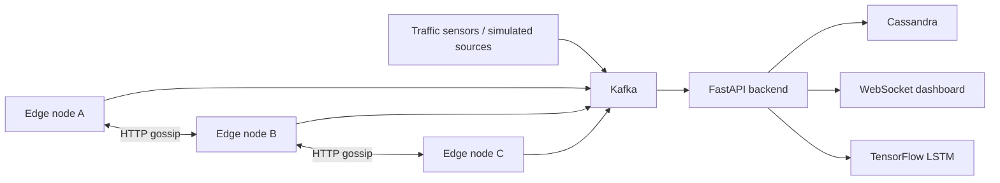

# TrafficX

TrafficX is a decentralized real-time traffic monitoring and congestion-prediction platform built with React/Vite, FastAPI, Kafka, Cassandra, TensorFlow, and HTTP gossip edge nodes.

## Architecture



Gossip is deliberately implemented as **HTTP gossip over multiple processes**, not libp2p or a DHT.

## Real vs simulated

| Component | Status |
|---|---|
| FastAPI REST, WebSocket, React dashboard | Real application code |
| Kafka and Cassandra integration | Real when Docker services are running |
| TensorFlow LSTM | Real model trained on synthetic or METR-LA data |
| Synthetic traffic observations | Simulated and labelled |
| HTTP edge gossip, peer discovery, signatures, ledger | Real implementation |
| Edge/node Kafka fallback and replay buffer | Bounded memory queue with ordered SQLite spill/replay when configured |
| Federated baseline | Optional experimental local linear training and signed gossip FedAvg; synthetic samples only |
| Raw traffic processing | UTC normalization, schema/range checks, bounded event-ID deduplication |
| Camera feed | Real YOLOv8 only when video/model are supplied; otherwise `camera-simulated` |
| GPS trace | Simulated, coordinates rounded for k-anonymity |
| Social feed | Simulated; DistilBERT or keyword fallback |
| TomTom, HERE, OpenWeather | Real only with API keys; otherwise simulated |

## ML metrics

Metrics in `results/ml_metrics.json` come from a real training run on the synthetic 60-day dataset.

| Horizon | LSTM MAE | LSTM RMSE | Persistence MAE | Train-mean MAE |
|---|---:|---:|---:|---:|
| +15 min | 3.7275 | 5.7186 | 4.4951 | 20.0977 |
| +30 min | 4.4293 | 6.9553 | 7.6645 | 20.1006 |
| +60 min | 4.9085 | 7.8116 | 13.2874 | 20.0929 |

The test set is chronological and the scaler is fitted only on the training split.

The anomaly model's latest synthetic holdout metrics are stored in `results/anomaly_metrics.json`: ML F1 0.1639 (precision 0.3390, recall 0.1081); rule baseline F1 0.2468 (precision 0.1851, recall 0.3703). The rule baseline currently has higher F1; these synthetic scores are not real-world validation.

## Run

```powershell
if (-not (Test-Path .env)) { Copy-Item .env.example .env }
docker compose config
docker compose up -d --build
docker compose ps
Invoke-RestMethod http://localhost:8000/health
```

Docker Compose builds and starts Kafka and Cassandra first, runs one-shot topic/schema initialization containers, then starts the backend, producers, three edge nodes, and frontend. Open `http://localhost:3000`; backend API docs are at `http://localhost:8000/api/docs`. The template `.env` is for local development; replace its secrets before exposing services.

The Compose file uses Bitnami's archived `bitnamilegacy/kafka:3.6.1` image to retain the current Kafka configuration. It is intended for local/demo use, not production deployments. Kafka is published at `localhost:9092` for host clients; services inside Compose should use `kafka:9092`.

On a fresh checkout, train optional local models from inside the running backend container, then restart services that load those artifacts:

```powershell
docker compose exec backend python -m app.ml.lstm_train --dataset synthetic --epochs 20 --seeds 3
docker compose exec backend python -m app.ml.anomaly_train
docker compose restart backend node-a node-b node-c
```

`docker compose down` stops the stack while retaining database and edge spill volumes. Avoid `docker compose down -v` unless you intend to delete that stored data.

Benchmarks:

```bash
# PowerShell
$env:GOSSIP_NODE_SETS = "3=http://localhost:7001,http://localhost:7002,http://localhost:7003"
python benchmarks/bench_gossip.py
python benchmarks/bench_api.py
python benchmarks/bench_e2e.py
python benchmarks/bench_fault.py --execute
```

These scripts require a running stack and report only measured results. `bench_fault.py` stops and restarts the specifically named Docker containers; review its arguments and use `--execute` deliberately. The gossip benchmark supports separately configured 3-, 6-, and 12-node URL sets via `GOSSIP_NODE_SETS` (semicolon-separated groups). The complete Docker Compose file starts three edge nodes.

`results/bench_api.json` contains 50 sequential local demo-mode requests to `/api/traffic/locations` (p50 0.86 ms, p95 1.15 ms on the current development machine). This is a simulated-provider API measurement, not full-stack or production performance.

The default stack uses simulated camera/GPS/social inputs unless real source configuration is supplied. Train the LSTM and anomaly models from `backend/` before the compose run if you want model-backed inference; generated model artifacts are local outputs and are not included in source control.

Set `ENABLE_FEDERATED=true` in `.env` to enable the experimental edge linear-regression baseline. Nodes exchange signed model weights, sample counts, and validation metrics while keeping observations local; they train on simulated local samples and report a rolling held-out MAE. This is not federated LSTM training and does not provide differential privacy or secure aggregation.

## Render deployment

The backend can serve Delhi NCR road-flow readings from TomTom when `TOMTOM_API_KEY` is configured. Without the key, traffic endpoints deliberately return readings labelled `simulated`; adding `DEMO_MODE=false` does not provide a traffic data source.

Smart Routes uses the backend `POST /api/routes/` endpoint to geocode Indian place names and calculate traffic-aware driving routes through TomTom Search and Routing APIs. Enable both APIs for the TomTom key. The key stays on the backend; the frontend calls this endpoint through `VITE_API_URL`. TomTom supplies route geometry, estimated travel time, and traffic delay; it does not provide the dashboard's demo congestion-by-road-segment values.

For a Render Docker web service:

1. Set the Dockerfile path to `backend/Dockerfile` (or set the root directory to `backend` and use `Dockerfile`).
2. Set `TOMTOM_API_KEY` to a TomTom Traffic API key in the service's environment. Keep it out of frontend variables and source control.
3. If the frontend is hosted separately, set its build-time `VITE_API_URL` to the backend URL, for example `https://trafficx-9zwj.onrender.com`. For a Docker frontend, provide it as the Docker build argument; a runtime-only variable will not be embedded in the Vite bundle.
4. Set backend `CORS_ORIGINS` to a JSON array containing the exact frontend origin, such as `["https://your-frontend.onrender.com"]`.
5. Redeploy both services after changing environment variables. Check `/health` and `/api/traffic/locations`; the returned `source` field should be `tomtom` for live provider readings and `simulated` for fallback readings.

The dashboard samples current road-flow readings once per minute for its session chart. The weekly chart is illustrative sample history, not stored real-world history. Kafka, Cassandra, and the trained LSTM remain separate optional integrations and are reported independently by the health endpoint.

## Security

Copy `.env.example` to `.env`. Set `JWT_SECRET`, `NETWORK_SECRET`, API keys, and `ALLOWED_ORIGINS`. Do not use demo credentials or the default network secret outside local development.

## SDG impact

- **UN SDG 11:** supports safer, more efficient urban mobility through congestion monitoring and route insight.
- **UN SDG 3:** faster traffic-anomaly visibility can support road-safety response.

These are potential impact goals, not measured safety outcomes.
