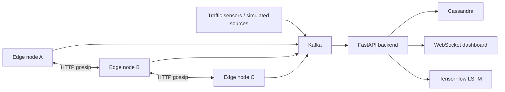

# TrafficX

TrafficX is a decentralized real-time traffic monitoring and congestion-prediction platform built with React/Vite, FastAPI, Kafka, Cassandra, TensorFlow, and HTTP gossip edge nodes.

## Architecture



Gossip is deliberately implemented as **HTTP gossip over multiple processes**, not libp2p or a DHT.

## Real vs simulated

| Component | Status |
|---|---|
| FastAPI REST, WebSocket, React dashboard | Real application code |
| Kafka and Cassandra integration | Real when Docker services are running |
| TensorFlow LSTM | Real model trained on synthetic or METR-LA data |
| Synthetic traffic observations | Simulated and labelled |
| HTTP edge gossip, peer discovery, signatures, ledger | Real implementation |
| Edge/node Kafka fallback and replay buffer | Real implementation |
| Camera feed | Real YOLOv8 only when video/model are supplied; otherwise `camera-simulated` |
| GPS trace | Simulated, coordinates rounded for k-anonymity |
| Social feed | Simulated; DistilBERT or keyword fallback |
| TomTom, HERE, OpenWeather | Real only with API keys; otherwise simulated |

## ML metrics

Metrics in `results/ml_metrics.json` come from a real training run on the synthetic 60-day dataset.

| Horizon | LSTM MAE | LSTM RMSE | Persistence MAE | Train-mean MAE |
|---|---:|---:|---:|---:|
| +15 min | 3.7275 | 5.7186 | 4.4951 | 20.0977 |
| +30 min | 4.4293 | 6.9553 | 7.6645 | 20.1006 |
| +60 min | 4.9085 | 7.8116 | 13.2874 | 20.0929 |

The test set is chronological and the scaler is fitted only on the training split.

## Run

```bash
docker compose up -d kafka cassandra
docker compose up kafka-init cassandra-init
cd backend
python -m app.ml.lstm_train --dataset synthetic --epochs 20 --seeds 3
python -m app.ml.anomaly_train
cd ..
python -m pytest tests/test_predictor_alignment.py -q
python -m pytest tests/test_integration.py -q
docker compose up -d
cd frontend && npm install && npm run dev
```

Benchmarks:

```bash
sh benchmarks/run_all.sh
```

Benchmark scripts report placeholders for measurements that require a running Docker stack; they do not invent successful measurements.

## Render deployment

The backend can serve Delhi NCR road-flow readings from TomTom when `TOMTOM_API_KEY` is configured. Without the key, traffic endpoints deliberately return readings labelled `simulated`; adding `DEMO_MODE=false` does not provide a traffic data source.

Smart Routes uses the backend `POST /api/routes/` endpoint to geocode Indian place names and calculate traffic-aware driving routes through TomTom Search and Routing APIs. Enable both APIs for the TomTom key. The key stays on the backend; the frontend calls this endpoint through `VITE_API_URL`. TomTom supplies route geometry, estimated travel time, and traffic delay; it does not provide the dashboard's demo congestion-by-road-segment values.

For a Render Docker web service:

1. Set the Dockerfile path to `backend/Dockerfile` (or set the root directory to `backend` and use `Dockerfile`).
2. Set `TOMTOM_API_KEY` to a TomTom Traffic API key in the service's environment. Keep it out of frontend variables and source control.
3. If the frontend is hosted separately, set its build-time `VITE_API_URL` to the backend URL, for example `https://trafficx-9zwj.onrender.com`. For a Docker frontend, provide it as the Docker build argument; a runtime-only variable will not be embedded in the Vite bundle.
4. Set backend `CORS_ORIGINS` to a JSON array containing the exact frontend origin, such as `["https://your-frontend.onrender.com"]`.
5. Redeploy both services after changing environment variables. Check `/health` and `/api/traffic/locations`; the returned `source` field should be `tomtom` for live provider readings and `simulated` for fallback readings.

The dashboard samples current road-flow readings once per minute for its session chart. The weekly chart is illustrative sample history, not stored real-world history. Kafka, Cassandra, and the trained LSTM remain separate optional integrations and are reported independently by the health endpoint.

## Security

Copy `.env.example` to `.env`. Set `JWT_SECRET`, `NETWORK_SECRET`, API keys, and `ALLOWED_ORIGINS`. Do not use demo credentials or the default network secret outside local development.

## SDG impact

- **UN SDG 11:** supports safer, more efficient urban mobility through congestion monitoring and route insight.
- **UN SDG 3:** faster traffic-anomaly visibility can support road-safety response.

These are potential impact goals, not measured safety outcomes.
